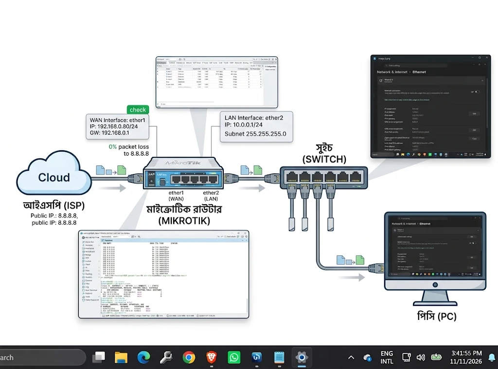

# MikroTik Router & LAN/WAN Topology Configuration

Configured and verified a network infrastructure using a MikroTik router to ensure seamless and efficient LAN-to-WAN communication. This project serves as a practical implementation to understand fundamental networking concepts in a controlled environment.

---

### 🌐 Network Topology Diagram

Here is the visual representation of the implemented network. It showcases the flow from the external ISP, through the central MikroTik Router, down to the switch, and the final end-host workstation. It highlights the primary configuration parameters on each segment.

  

**Visual Highlights in Diagram:**
* **ISP Link:** Static IPv4 address `192.168.0.80` on `ether1` (WAN) and validation showing `0% packet loss` to Google DNS (`8.8.8.8`).
* **MikroTik Router:** Interface and Route tables matching the configuration.
* **LAN Segment:** Private IPv4 subnet `10.0.0.1/24` on `ether2`, connected to a Switch.
* **PC Config:** Workstation statically assigned `10.0.0.2` on the LAN.

---

### 🛠️ Configuration Steps

This project follows a precise, step-by-step configuration process on both the MikroTik router (using WinBox/Terminal) and the client workstation (Windows OS).

#### Step 1: Physical Setup & Initial Access
* Connect the ISP uplink cable to `ether1` (marked as WAN in image).
* Connect the LAN switch and PC to `ether2` (LAN in image).
* Access the MikroTik router using WinBox and default credentials.

#### Step 2: Configure WAN Interface (ISP Link)
* **Navigate:** `IP` -> `Addresses` -> `New Address`.
* **Action:** Assign `192.168.0.80/24` to the `ether1` interface.
* **Navigate:** `IP` -> `Routes` -> `New Route`.
* **Action:** Set the Default Static Route `0.0.0.0/0` via the Gateway IP `192.168.0.1`.
* **Navigate:** `IP` -> `DNS`.
* **Action:** Add Public DNS (e.g., `8.8.8.8` and `8.8.4.4`).
* **Verify:** Open a terminal in WinBox and execute `ping 8.8.8.8` to confirm the router has internet access with 0% packet loss.

#### Step 3: Configure LAN Interface
* **Navigate:** `IP` -> `Addresses` -> `New Address`.
* **Action:** Assign the local private network address `10.0.0.1/24` to the `ether2` interface.
* **Navigate:** `IP` -> `Firewall` -> `NAT`.
* **Action:** Add a NAT rule with chain `srcnat`, out-interface `ether1`, and action `masquerade` to enable LAN clients to share the internet connection.

#### Step 4: Configure Workstation (PC)
* On the Windows workstation, navigate to Network Connections settings.
* Select the Ethernet adapter, open Properties, and edit Internet Protocol Version 4 (TCP/IPv4).
* Select "Use the following IP address" and enter the following details:
    * **IP address:** `10.0.0.2`
    * **Subnet mask:** `255.255.255.0`
    * **Default gateway:** `10.0.0.1` (MikroTik LAN IP)
    * **Preferred DNS server:** `8.8.8.8`

#### Step 5: Final Validation
* Open a web browser or a command prompt on the PC and test external connectivity (e.g., `ping google.com`).

---

### 🎯 Key Implementations & Skill Showcase
* **MikroTik RouterOS:** Proficiency in fundamental configuration via GUI (WinBox) and CLI.
* **Network Infrastructure:** Designing and implementing a functional network topology with switches and routers.
* **IPv4 Subnetting:** Correct allocation and use of static public and private subnets.
* **Static Routing:** Establishing a default static route to a gateway.
* **Network Troubleshooting:** Using standard tools like ICMP ping for path verification.
